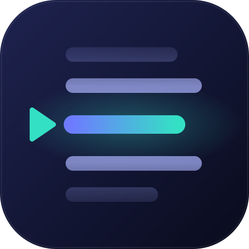

<p align="center"></p>

<h1 align="center">Teleprompter</h1>

<p align="center">
  <b>A free, private teleprompter that runs in your browser.</b><br>
  Words-per-minute scrolling · mirror mode for glass rigs · camera preview and recording · FR / EN<br>
  Optional voice following · nothing uploaded by default · no account · works offline
</p>

<p align="center">
  <a href="https://ldws123.github.io/teleprompter/"><b>▶ Open the app</b></a> ·
  <a href="https://github.com/LdwS123/teleprompter/actions/workflows/ci.yml"></a>
</p>

---

## Why

Most teleprompter apps are paid, ad-ridden or send your script to a server. This one is a single static page:
paste a script, press play, read to camera, and (optionally) record the take right in the browser.

## Features

- **Real reading speed.** You set *words per minute*, not an abstract slider. The scroll speed is derived from your
  text, so a 150 wpm script really takes the time the counter shows.
- **Follow my voice** (optional). The text advances when *you* read: spoken words are matched against the script, with
  tolerance for accents, small recognition errors and skipped words. Words you've read dim, the next one is highlighted.
  Pause and it waits; scroll by hand and it re-syncs. Needs a browser with speech recognition (Chrome, Edge, Safari).
- **Reading line** at 38% of the screen, with fade-out top and bottom, so your eyes stay near the lens.
- **Mirror mode** for beam-splitter glass rigs.
- **Camera preview + recording** (video and mic), saved as MP4/WebM when the script ends. The recording is *not* mirrored
  and never contains the prompter text.
- **Director notes**: a line starting with `//` shows small and is never counted. `[pause]`, `[smile]`... become coloured cues.
- **Countdown**, progress bar, auto-hiding controls, screen wake-lock, fullscreen.
- **Phone friendly**: tap to play/pause, drag to scroll by hand.
- Script and settings are saved in your browser (`localStorage`). Import / export `.txt`.

## Keyboard

| Key | Action |
|---|---|
| `Space` | play / pause |
| `↑` `↓` | speed ±5 wpm |
| `+` `-` | text size |
| `M` | mirror |
| `R` | restart |
| `Esc` | exit |
| `Ctrl/⌘ + Enter` | start from the editor |

## Run it

```bash
git clone https://github.com/LdwS123/teleprompter && cd teleprompter
python3 -m http.server 8000      # then open http://localhost:8000
```

No build step, no dependencies. Camera access needs `https://` or `localhost`, which GitHub Pages provides.

## Develop

```bash
npm test      # unit tests for the pure logic in core.js (node:test, zero dependencies)
```

Layout: `core.js` (pure logic: parsing, word count, wpm to px/s), `app.js` (UI), `style.css`, `index.html`.

## Privacy

Everything runs locally and the page makes no network requests besides loading its own files, **except** if you turn on
*Follow my voice*: the browser's speech recognition is what listens, and Chrome sends that audio to Google's servers.
The option is off by default and explained next to the checkbox. Your script and any recorded video are never uploaded.

## License

MIT
